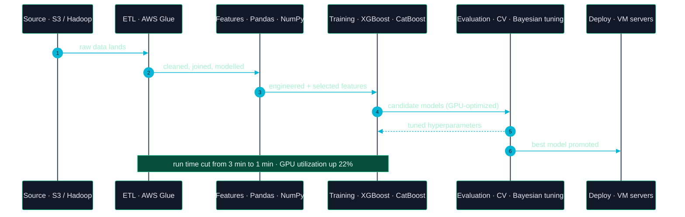
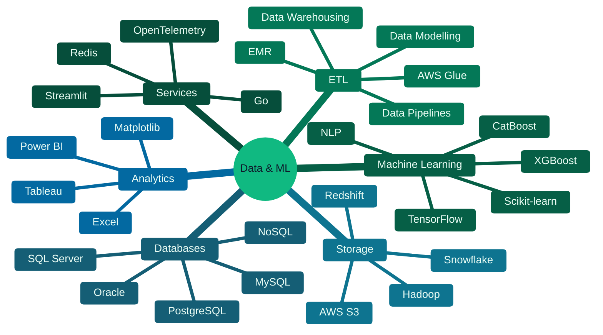
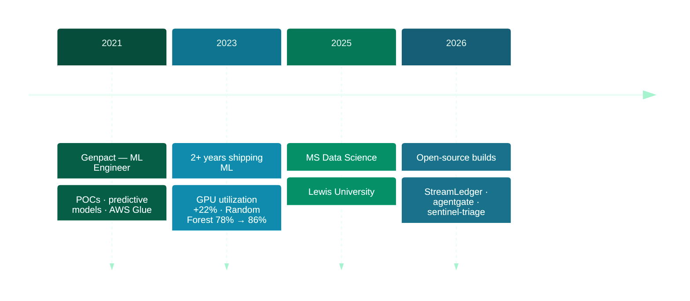

```bash
$ whoami
```

```yaml
name:        Sai Teja Goriparthi
role:        Data Engineer · Machine Learning Engineer
focus:       data pipelines, ML models in production, analytics
previously:  Genpact — Machine Learning Engineer (2021–2023)
education:   MS Data Science @ Lewis University (May 2025)
credentials: Google Data Analyst · ML with Python · SAS Essentials · SQL for Data Science
reachable:   goriparthisaiteja@gmail.com
```

<p>
  <a href="https://github.com/Sgoriparthi21"></a>
  <a href="mailto:goriparthisaiteja@gmail.com"></a>
  <a href="tel:+17794454934"></a>
</p>

---

### &nbsp;❯&nbsp; What I build

<table>
<tr>
<td width="33%" valign="top" align="center">

**Data Pipelines**

<sub>ETL on AWS Glue, S3, EMR and Hadoop feeding Snowflake and Redshift, with the data modelling done up front.</sub>

</td>
<td width="33%" valign="top" align="center">

**Production ML Models**

<sub>XGBoost, CatBoost and Random Forest models taken from proof of concept to deployment, tuned with Bayesian Optimization.</sub>

</td>
<td width="33%" valign="top" align="center">

**Reliable Data Services**

<sub>Event-sourced ledgers, API gateways and log-triage pipelines built with tests, audit trails and metrics.</sub>

</td>
</tr>
</table>

---

### &nbsp;❯&nbsp; How a model gets from raw data to production



---

### &nbsp;❯&nbsp; Engineering principles

> **Measure before you optimize.** Profile the run time and the GPU first; cutting an algorithm from 3 minutes to 1 started with knowing where the time went.

> **Tune with evidence, not guesses.** Cross-validation and Bayesian Optimization took a Random Forest from 78% to 86% accuracy.

> **A model isn't done until it ships.** Code reviews, end-to-end tests and automated deployment are part of the work, not an afterthought.

---

### &nbsp;❯&nbsp; Technology ecosystem



<sub>Primary languages &nbsp;→&nbsp; <code>Python</code> · <code>SQL</code> · <code>R</code> · <code>SAS</code> · <code>Go</code> &nbsp;&nbsp;·&nbsp;&nbsp; Also worked with &nbsp;→&nbsp; <code>Java</code> · <code>C</code> · <code>C#</code> · <code>Ruby</code> · <code>PowerShell</code> · <code>Docker</code> · <code>JIRA</code></sub>

---

### &nbsp;❯&nbsp; Career journey



| Period | Company | Role | Key impact |
|:--|:--|:--|:--|
| **Jul 2021 — Aug 2023** | Genpact India Pvt Ltd. | Machine Learning Engineer | Run time 3 → 1 min · 22% better GPU utilization · Random Forest accuracy 78% → 86% |

---

### &nbsp;❯&nbsp; Featured engineering projects

<details open>
<summary><b>StreamLedger</b> &nbsp;—&nbsp; event-sourced ledger with no double-spends &nbsp;·&nbsp; <a href="https://github.com/Sgoriparthi21/streamledger">repo</a></summary>

<br>

Event-sourced, CQRS-projected ledger for balances and inventory. Every state change is an append-only event; **optimistic concurrency** stops two concurrent writers from both winning, and **dedupe keys** make retried commands replay the original result. Delivery is at-least-once with idempotent consumers, so processing is effectively-once. **48+ tests** run fully in memory; Postgres and NATS JetStream implementations sit behind integration tags.

```mermaid
%%{init: {"theme":"base","themeVariables":{"darkMode":true,"background":"#0F172A","git0":"#10B981","gitBranchLabel0":"#0F172A","primaryColor":"#111827","primaryBorderColor":"#10B981","primaryTextColor":"#E2E8F0","secondaryColor":"#064E3B","secondaryBorderColor":"#34D399","secondaryTextColor":"#ECFDF5","tertiaryColor":"#0B1220","tertiaryBorderColor":"#06B6D4","tertiaryTextColor":"#E2E8F0","mainBkg":"#111827","nodeBorder":"#10B981","clusterBkg":"#0B1220","clusterBorder":"#1E293B","lineColor":"#06B6D4","textColor":"#A7F3D0","edgeLabelBackground":"#0F172A","actorBkg":"#111827","actorBorder":"#10B981","actorTextColor":"#E2E8F0","actorLineColor":"#334155","signalColor":"#06B6D4","signalTextColor":"#A7F3D0","labelBoxBkgColor":"#111827","labelBoxBorderColor":"#10B981","labelTextColor":"#E2E8F0","loopTextColor":"#A7F3D0","noteBkgColor":"#064E3B","noteBorderColor":"#34D399","noteTextColor":"#ECFDF5","activationBkgColor":"#047857","activationBorderColor":"#34D399","sequenceNumberColor":"#0F172A","cScale0":"#064E3B","cScaleLabel0":"#ECFDF5","cScalePeer0":"#34D399","cScale1":"#0E7490","cScaleLabel1":"#ECFDF5","cScalePeer1":"#34D399","cScale2":"#047857","cScaleLabel2":"#ECFDF5","cScalePeer2":"#34D399","cScale3":"#155E75","cScaleLabel3":"#ECFDF5","cScalePeer3":"#34D399","cScale4":"#065F46","cScaleLabel4":"#ECFDF5","cScalePeer4":"#34D399","cScale5":"#0369A1","cScaleLabel5":"#ECFDF5","cScalePeer5":"#34D399","cScale6":"#064E3B","cScaleLabel6":"#ECFDF5","cScalePeer6":"#34D399","cScale7":"#0E7490","cScaleLabel7":"#ECFDF5","cScalePeer7":"#34D399","cScale8":"#047857","cScaleLabel8":"#ECFDF5","cScalePeer8":"#34D399","cScale9":"#155E75","cScaleLabel9":"#ECFDF5","cScalePeer9":"#34D399","cScale10":"#065F46","cScaleLabel10":"#ECFDF5","cScalePeer10":"#34D399","cScale11":"#0369A1","cScaleLabel11":"#ECFDF5","cScalePeer11":"#34D399"}}}%%
flowchart LR
    C["Commands<br>gRPC API"] --> D["Decide<br>optimistic concurrency"]
    D --> L[("Append-only<br>event log")]
    L --> B[["Event bus<br>NATS JetStream"]]
    B --> P["Projections<br>read models"]
    P --> Q["Queries"]
    P -.-> M[["Prometheus"]]
    style L fill:#064E3B,stroke:#34D399,color:#ECFDF5
    style Q fill:#164E63,stroke:#06B6D4,color:#ECFDF5
```



<sub>`Go` `Event Sourcing` `CQRS` `gRPC` `PostgreSQL` `NATS JetStream` `Prometheus`</sub>

</details>

<details>
<summary><b>agentgate</b> &nbsp;—&nbsp; policy and budget gateway for LLM agents &nbsp;·&nbsp; <a href="https://github.com/Sgoriparthi21/agentgate">repo</a></summary>

<br>

Gateway between LLM agents and internal REST APIs. Builds a tool catalog from an OpenAPI spec, gives each agent a scoped API key, applies allow/deny policy rules, and enforces per-agent, per-tool rate limits and cost budgets in Redis. Every call, allowed or denied, lands in a Postgres audit log with a replay endpoint and one OpenTelemetry trace across the request.

```mermaid
%%{init: {"theme":"base","themeVariables":{"darkMode":true,"background":"#0F172A","git0":"#10B981","gitBranchLabel0":"#0F172A","primaryColor":"#111827","primaryBorderColor":"#10B981","primaryTextColor":"#E2E8F0","secondaryColor":"#064E3B","secondaryBorderColor":"#34D399","secondaryTextColor":"#ECFDF5","tertiaryColor":"#0B1220","tertiaryBorderColor":"#06B6D4","tertiaryTextColor":"#E2E8F0","mainBkg":"#111827","nodeBorder":"#10B981","clusterBkg":"#0B1220","clusterBorder":"#1E293B","lineColor":"#06B6D4","textColor":"#A7F3D0","edgeLabelBackground":"#0F172A","actorBkg":"#111827","actorBorder":"#10B981","actorTextColor":"#E2E8F0","actorLineColor":"#334155","signalColor":"#06B6D4","signalTextColor":"#A7F3D0","labelBoxBkgColor":"#111827","labelBoxBorderColor":"#10B981","labelTextColor":"#E2E8F0","loopTextColor":"#A7F3D0","noteBkgColor":"#064E3B","noteBorderColor":"#34D399","noteTextColor":"#ECFDF5","activationBkgColor":"#047857","activationBorderColor":"#34D399","sequenceNumberColor":"#0F172A","cScale0":"#064E3B","cScaleLabel0":"#ECFDF5","cScalePeer0":"#34D399","cScale1":"#0E7490","cScaleLabel1":"#ECFDF5","cScalePeer1":"#34D399","cScale2":"#047857","cScaleLabel2":"#ECFDF5","cScalePeer2":"#34D399","cScale3":"#155E75","cScaleLabel3":"#ECFDF5","cScalePeer3":"#34D399","cScale4":"#065F46","cScaleLabel4":"#ECFDF5","cScalePeer4":"#34D399","cScale5":"#0369A1","cScaleLabel5":"#ECFDF5","cScalePeer5":"#34D399","cScale6":"#064E3B","cScaleLabel6":"#ECFDF5","cScalePeer6":"#34D399","cScale7":"#0E7490","cScaleLabel7":"#ECFDF5","cScalePeer7":"#34D399","cScale8":"#047857","cScaleLabel8":"#ECFDF5","cScalePeer8":"#34D399","cScale9":"#155E75","cScaleLabel9":"#ECFDF5","cScalePeer9":"#34D399","cScale10":"#065F46","cScaleLabel10":"#ECFDF5","cScalePeer10":"#34D399","cScale11":"#0369A1","cScaleLabel11":"#ECFDF5","cScalePeer11":"#34D399"}}}%%
flowchart LR
    A["LLM agent"] --> U["Auth<br>API key · JWT"] --> P["Policy<br>allow / deny"] --> R["Redis<br>rate & budget"] --> S["OpenAPI tool schema"] --> API["Downstream API"]
    P -.-> L[("Postgres<br>audit log")]
    style L fill:#064E3B,stroke:#34D399,color:#ECFDF5
```



<sub>`Python` `Redis` `PostgreSQL` `OpenAPI` `OpenTelemetry` `Docker Compose`</sub>

</details>

<details>
<summary><b>sentinel-triage</b> &nbsp;—&nbsp; correlating security logs into incidents &nbsp;·&nbsp; <a href="https://github.com/Sgoriparthi21/sentinel-triage">repo</a></summary>

<br>

Streams endpoint and auth logs through Redis Streams into OpenSearch, clusters events per user into candidate incidents, and matches them against Sigma rules mapped to MITRE ATT&CK. An LLM summarizes each incident and must cite the log lines it used. An eval harness reports **precision, recall and false-positive rate** against a labeled dataset.

<sub>`Python` `Redis Streams` `OpenSearch` `Sigma` `MITRE ATT&CK` `LLM`</sub>

</details>

<details>
<summary><b>Text Analysis with NLP</b> &nbsp;—&nbsp; interactive Streamlit app &nbsp;·&nbsp; <a href="https://github.com/Sgoriparthi21/text-analysis-using-nlp-streamlit">repo</a></summary>

<br>

Streamlit app for text preprocessing, sentiment analysis, named entity recognition, part-of-speech tagging and word clouds, with adjustable parameters for each task.

<sub>`Python` `NLP` `Streamlit`</sub>

</details>

---

### &nbsp;❯&nbsp; Impact at a glance

<table>
<tr>
<td align="center" width="20%"><b>2+ yrs</b><br><sub>ML & data engineering</sub></td>
<td align="center" width="20%"><b>3 → 1 min</b><br><sub>algorithm run time</sub></td>
<td align="center" width="20%"><b>22%</b><br><sub>better GPU utilization</sub></td>
<td align="center" width="20%"><b>78% → 86%</b><br><sub>Random Forest accuracy</sub></td>
<td align="center" width="20%"><b>4</b><br><sub>certifications</sub></td>
</tr>
</table>

---

### &nbsp;❯&nbsp; GitHub

<!-- animated contribution graph + stats card, built from real data.
     regenerated daily by .github/workflows/update-profile-art.yml
     (scripts/fetch_contributions.py → render_heatmap_svg.py → render_stats_svg.py) -->

<div align="center">

<h3><code>sgoriparthi21@github ~ $ ./contributions.sh</code></h3>


<br>
<br>

<h3><code>sgoriparthi21@github ~ $ ./stats.sh</code></h3>



</div>

---

### &nbsp;❯&nbsp; Currently exploring

```text
→ event sourcing and CQRS for correct-under-concurrency data
→ guardrails, budgets and audit trails for LLM agents
→ eval harnesses that put a number on detection quality
```

---

<div align="center">

```bash
$ reach me
→ email     goriparthisaiteja@gmail.com
→ github    github.com/Sgoriparthi21
→ phone     +1 (779) 445-4934
```

<sub>Open to data engineering and machine learning engineering roles.</sub>

</div>
